<div align="center">

# Pokopia Controller Icons <br>

[](LICENSE)

 <br>

[](README.md)
[](README.br.md)

Troque os ícones do Switch pelos de PlayStation, Xbox, Steam Deck ou teclado no Pokémon Pokopia! <br>
O mod modifica apenas a textura necessária, sem recomprimir e mantendo a qualidade original <br>
São 27 ícones nos menus e avisos, desenhados no estilo do próprio jogo :)


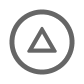


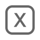

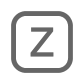


</div>
<br>

## Instalação (ou troca de layout)

### ZIP (recomendado)

1. Baixe o ZIP do seu controle, ou o de teclado (não precisa extrair)

   | Controle | ZIP |
   | --- | --- |
   | DualSense, DualSense Edge, DualShock 4 | [PlayStation](https://github.com/dumpsabfuck/pokopia-controller-icons/releases/latest/download/pokopia-playstation-icons.zip) |
   | Xbox, ROG Ally e outros com o A embaixo | [Xbox](https://github.com/dumpsabfuck/pokopia-controller-icons/releases/latest/download/pokopia-xbox-icons.zip) |
   | Steam Deck | [Steam Deck](https://github.com/dumpsabfuck/pokopia-controller-icons/releases/latest/download/pokopia-steam-deck-icons.zip) |
   | Teclado | [Teclado](https://github.com/dumpsabfuck/pokopia-controller-icons/releases/latest/download/pokopia-keyboard-icons.zip) |

2. No emulador, clique com o botão direito no jogo e depois em `Configure Game`
3. Na aba `Add-Ons`, clique em `Import Mod from ZIP`, escolha o arquivo e dê `OK` no nome que aparecer
4. Agora é só abrir o jogo :)

<details>
    <summary>
        <strong>Não encontrei um botão que você citou</strong>
    </summary>

Na página inicial do emulador, onde tem os jogos, clique com o botão direito no jogo, depois em `Open Mod Data Location`, e arraste a pasta `Controller Icons` de dentro do ZIP que você baixou pra pasta que abrir.

</details>

### Manual

<details>
    <summary>
        <strong>Ver o passo a passo</strong>
    </summary>

1. Instale o [Python 3.9](https://www.python.org/downloads/) ou mais novo (se o instalador perguntar, marque `Add python.exe to PATH`)
2. Baixe [este repositório em ZIP](https://github.com/dumpsabfuck/pokopia-controller-icons/archive/refs/heads/main.zip) e extraia os arquivos
3. Feche o jogo
4. Ache a pasta `KIDS_PLATFORM_OUNCE` do update 2.0.1a (onde ficam o `root.rdb` e o `0x00011c54.fdata`)
5. Na pasta onde está o `apply.py`, clique na barra de endereço, digite `cmd` e aperte Enter
6. Rode o `apply.py` com o seu layout (`playstation`, `xbox`, `steam-deck` ou `keyboard`):

   ```bash
   python apply.py playstation "{GAME_FOLDER_PATH}\updates\655360\romfs\motor_asset_re\KIDS_PLATFORM_OUNCE" "{MODS_FOLDER_PATH}\Controller Icons"
   ```

   `{GAME_FOLDER_PATH}` é a pasta do jogo, e `{MODS_FOLDER_PATH}` é a pasta que abre no `Open Mod Data Location`.

   A estrutura deve ficar parecida com isso:

   ```
   📂 load
   └── 📂 0400A3A01EE4C000
       └── 📂 Controller Icons
           ├── 📂 romfs
           └── 📂 romfs_ext
   ```

7. Agora é só abrir o jogo :)

</details>

## Desinstalação

Clique com o botão direito no jogo, depois em `Open Mod Data Location`, e apague a pasta `Controller Icons`.

## Ícones

<details>
    <summary>
        <strong>Ver os ícones de PlayStation</strong>
    </summary>

| Botão do Switch | Ícone | Botão do controle |
| --- | --- | --- |
| A, B, X, Y |     | Círculo, cruz, triângulo, quadrado |
| L, R | 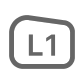 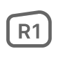 | L1, R1 |
| ZL, ZR | 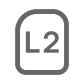 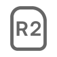 | L2, R2 |
| Analógico esquerdo, analógico direito |   | L, R |
| Clique dos analógicos |   | L3, R3 |
| + |  | Options |
| − |  | Create |
| Capture |  | Microfone |
| Home |  | PS |
| Direcional | 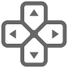 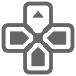  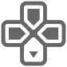 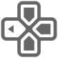 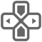 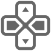 | Direcional |
| Setas |     | Setas do direcional |

</details>

<details>
    <summary>
        <strong>Ver os ícones de Xbox</strong>
    </summary>

| Botão do Switch | Ícone | Botão do controle |
| --- | --- | --- |
| A, B, X, Y |     | B, A, Y, X |
| L, R | 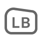  | LB, RB |
| ZL, ZR | 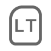  | LT, RT |
| Analógico esquerdo, analógico direito |   | L, R |
| Clique dos analógicos |   | LS, RS |
| + |  | Menu |
| − |  | View |
| Capture |  | Share |
| Home |  | Botão Xbox |
| Direcional | 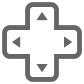    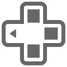  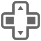 | Direcional |
| Setas |     | Setas do direcional |

</details>

<details>
    <summary>
        <strong>Ver os ícones de Steam Deck</strong>
    </summary>

| Botão do Switch | Ícone | Botão do controle |
| --- | --- | --- |
| A, B, X, Y |    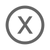 | B, A, Y, X |
| L, R |   | L1, R1 |
| ZL, ZR |   | L2, R2 |
| Analógico esquerdo, analógico direito |   | L, R |
| Clique dos analógicos | 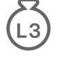 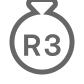 | L3, R3 |
| + |  | Menu |
| − |  | View |
| Capture |  | `...` |
| Home |  | Botão Steam |
| Direcional |  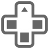    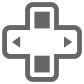  | Direcional |
| Setas |     | Setas do direcional |

</details>

<details>
    <summary>
        <strong>Ver os ícones de teclado</strong>
    </summary>

| Botão do Switch | Ícone | Tecla |
| --- | --- | --- |
| A, B, X, Y |     | C, X, V, Z |
| L, R |   | Q, E |
| ZL, ZR |   | R, T |
| Analógico esquerdo, analógico direito | 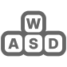 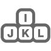 | WASD, IJKL |
| Clique dos analógicos |   | F, G |
| + |  | M |
| − | 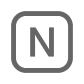 | N |
| Capture |  | Sem tecla padrão |
| Home | 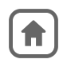 | Sem tecla padrão |
| Direcional | 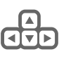      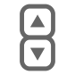 | Setas do teclado |
| Setas | 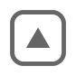    | Setas do teclado |

</details>

## Dúvidas

<details>
    <summary>
        <strong>Por que o botão A da tela de título não mudou?</strong>
    </summary>

Essa é uma textura que o mod não troca.

</details>

<details>
    <summary>
        <strong>Funciona junto com a tradução PT-BR?</strong>
    </summary>

Funciona. Testei com a [tradução 2.5.4](https://github.com/LucianoNeo/pokemon-pokopia-pt-br) e sem ela também.

</details>

<details>
    <summary>
        <strong>Mudei os botões no emulador e alguns ícones não batem</strong>
    </summary>

Os ícones seguem o mapeamento padrão do emulador, então não vão bater se você mudar os botões ou as teclas.

</details>

<details>
    <summary>
        <strong>Como eu troco um ícone?</strong>
    </summary>

Todos os ícones estão na pasta `icons`. Cada ícone é um PNG de 84x84. Edite o que quiser e gere os patches de novo.

Pra gerar os patches de novo, você precisa do Python 3.11 ou mais novo:

```bash
pip install -r requirements.txt
python build.py
```

Depois rode o `apply.py` como na [instalação manual](#manual).

</details>

<details>
    <summary>
        <strong>Como isso funciona por dentro?</strong>
    </summary>

O `root.rdb` diz onde cada recurso está: em qual `.fdata` (pela posição dele no `root.rdx`) e em que ponto dele. Os ícones estão na textura 18 do G1T `0xBC2C37F5`, dentro do `0x00011c54.fdata`. Cada arquivo em `patches/` guarda só os blocos BC7 dos ícones novos, nada do jogo. Só os blocos embaixo dos ícones mudam, e eles continuam em BC7, como no original.

O `apply.py` lê o G1T da sua cópia, confere o SHA-256 e grava esses blocos por cima. Depois salva o resultado num `.fdata` novo, o `0x0d5e1c05.fdata`, inclui esse arquivo numa cópia do `root.rdx` e grava um patch IPS de 23 bytes que faz o `root.rdb` apontar pra lá. O G1T tem 62 texturas e só o atlas dos botões muda, então o `.fdata` novo leva as outras 61 junto.

Se você quer aprender sobre esse tipo de mod, pode usar o projeto como material de estudo: o `apply.py` e o `build.py` são curtos e explicam no topo os formatos que usam. O `flip_gobs`, no `build.py`, mostra também a diferença entre o layout de textura do Switch 1 e o do Switch 2.

</details>

## Agradecimentos

- [RDBExplorer](https://github.com/MrIkso/RDBExplorer), pelos formatos RDB e `.fdata`.
- [gust_tools](https://github.com/VitaSmith/gust_tools), pelo formato G1T.
- ns2-assets, pelas anotações sobre texturas do Switch 2.
- [Inter](https://github.com/rsms/inter), a fonte dos textos dos botões.
- [Wikimedia Commons](https://commons.wikimedia.org/wiki/File:PlayStation_logo.svg), pelo vetor do logo PS.

## Aviso

Esse é um projeto independente, sem nenhuma ligação com a Nintendo, a The Pokémon Company, a Koei Tecmo, a Sony, a Microsoft, a Valve ou a ASUS, e nenhuma delas apoia ou patrocina o projeto. O código deste repositório não tem nenhum arquivo do jogo, mas o mod pronto traz cópias modificadas de um arquivo de texturas e do `root.rdx` do jogo, e a arte do jogo que está nele pertence aos seus donos. Pokémon e Pokopia são marcas dos seus donos. PlayStation, DualSense, DualShock e o logo PS são marcas da Sony Interactive Entertainment; Xbox, da Microsoft; Steam Deck, da Valve; e ROG Ally, da ASUS. A [licença MIT](LICENSE) vale pro código e pros ícones, não pras marcas citadas aqui nem pros arquivos do jogo.
