<div align="center">

# Pokopia Controller Icons <br>

[](LICENSE)

 <br>

[](README.md)
[](README.br.md)

PlayStation, Xbox, Steam Deck and keyboard icons for Pokémon Pokopia! <br>
The mod only changes the texture it needs, doesn't recompress it and keeps the original quality <br>
It swaps 27 Switch icons in the menus and prompts, drawn in the game's own style :)


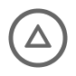


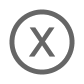

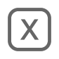

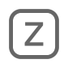

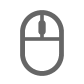

</div>
<br>

## Installation (or switching layouts)

### ZIP (recommended)

1. Download the ZIP for your controller, or the keyboard one (no need to extract it)

   | Controller | ZIP |
   | --- | --- |
   | DualSense, DualSense Edge, DualShock 4 | [PlayStation](https://github.com/dumpsabfuck/pokopia-controller-icons/releases/latest/download/pokopia-playstation-icons.zip) |
   | Xbox, ROG Ally and others with A at the bottom | [Xbox](https://github.com/dumpsabfuck/pokopia-controller-icons/releases/latest/download/pokopia-xbox-icons.zip) |
   | Steam Deck | [Steam Deck](https://github.com/dumpsabfuck/pokopia-controller-icons/releases/latest/download/pokopia-steam-deck-icons.zip) |
   | Keyboard | [Keyboard](https://github.com/dumpsabfuck/pokopia-controller-icons/releases/latest/download/pokopia-keyboard-icons.zip) |
   | Keyboard and mouse | [Keyboard and mouse](https://github.com/dumpsabfuck/pokopia-controller-icons/releases/latest/download/pokopia-keyboard-mouse-icons.zip) |

2. In the emulator, right-click the game and click `Configure Game`
3. In the `Add-Ons` tab, click `Import Mod from ZIP`, pick the file and click `OK` on the name it suggests
4. That's it, start the game :)

<details>
    <summary>
        <strong>I can't find a button you mentioned</strong>
    </summary>

On the emulator's main page, where your games are, right-click the game, click `Open Mod Data Location` and drag the `Controller Icons` folder from inside the ZIP you downloaded into the folder that opens.

</details>

### Manual

<details>
    <summary>
        <strong>See the steps</strong>
    </summary>

1. Get [Python 3.9](https://www.python.org/downloads/) or newer (if the installer asks, tick `Add python.exe to PATH`)
2. Download [this repo as a ZIP](https://github.com/dumpsabfuck/pokopia-controller-icons/archive/refs/heads/main.zip) and extract it
3. Close the game
4. Find the `KIDS_PLATFORM_OUNCE` folder from update 2.0.1a (the one with `root.rdb` and `0x00011c54.fdata`)
5. In the folder with `apply.py`, click the address bar, type `cmd` and press Enter
6. Run `apply.py` with your layout (`playstation`, `xbox`, `steam-deck`, `keyboard` or `keyboard-mouse`):

   ```bash
   python apply.py playstation "{GAME_FOLDER_PATH}\updates\655360\romfs\motor_asset_re\KIDS_PLATFORM_OUNCE" "{MODS_FOLDER_PATH}\Controller Icons"
   ```

   `{GAME_FOLDER_PATH}` is the game's folder, and `{MODS_FOLDER_PATH}` is the folder that opens with `Open Mod Data Location`.

   The structure should look something like this:

   ```
   📂 load
   └── 📂 0400A3A01EE4C000
       └── 📂 Controller Icons
           ├── 📂 romfs
           └── 📂 romfs_ext
   ```

7. That's it, start the game :)

</details>

## Uninstall

Right-click the game, click `Open Mod Data Location` and delete the `Controller Icons` folder.

## Icons

<details>
    <summary>
        <strong>See the PlayStation icons</strong>
    </summary>

| Switch button | Icon | Controller button |
| --- | --- | --- |
| A, B, X, Y |     | Circle, cross, triangle, square |
| L, R | 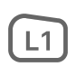 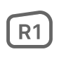 | L1, R1 |
| ZL, ZR | 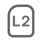 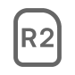 | L2, R2 |
| Left stick, right stick |   | L, R |
| Stick clicks | 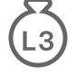 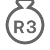 | L3, R3 |
| + |  | Options |
| − |  | Create |
| Capture |  | Microphone |
| Home |  | PS |
| D-pad | 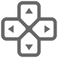 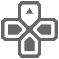  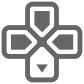 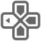 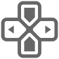 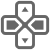 | D-pad |
| Arrows |     | D-pad arrows |

</details>

<details>
    <summary>
        <strong>See the Xbox icons</strong>
    </summary>

| Switch button | Icon | Controller button |
| --- | --- | --- |
| A, B, X, Y |     | B, A, Y, X |
| L, R | 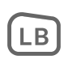  | LB, RB |
| ZL, ZR | 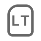  | LT, RT |
| Left stick, right stick |   | L, R |
| Stick clicks |   | LS, RS |
| + |  | Menu |
| − |  | View |
| Capture |  | Share |
| Home |  | Xbox button |
| D-pad | 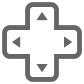 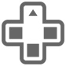   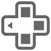 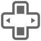 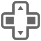 | D-pad |
| Arrows |     | D-pad arrows |

</details>

<details>
    <summary>
        <strong>See the Steam Deck icons</strong>
    </summary>

| Switch button | Icon | Controller button |
| --- | --- | --- |
| A, B, X, Y |     | B, A, Y, X |
| L, R |   | L1, R1 |
| ZL, ZR |   | L2, R2 |
| Left stick, right stick |   | L, R |
| Stick clicks |   | L3, R3 |
| + |  | Menu |
| − |  | View |
| Capture |  | `...` |
| Home |  | Steam button |
| D-pad |        | D-pad |
| Arrows |     | D-pad arrows |

</details>

<details>
    <summary>
        <strong>See the keyboard icons</strong>
    </summary>

| Switch button | Icon | Key |
| --- | --- | --- |
| A, B, X, Y |     | C, X, V, Z |
| L, R |   | Q, E |
| ZL, ZR |   | R, T |
| Left stick, right stick | 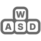 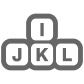 | WASD, IJKL |
| Stick clicks |   | F, G |
| + |  | M |
| − |  | N |
| Capture |  | No default key |
| Home | 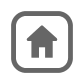 | No default key |
| D-pad | 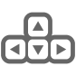 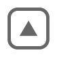     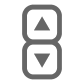 | Arrow keys |
| Arrows |     | Arrow keys |

</details>

<details>
    <summary>
        <strong>See the keyboard and mouse icons</strong>
    </summary>

Same as the keyboard, but the right stick becomes the mouse: 

</details>

## FAQ

<details>
    <summary>
        <strong>Why didn't the A button on the title screen change?</strong>
    </summary>

That's a texture this mod doesn't change.

</details>

<details>
    <summary>
        <strong>Does it work with the PT-BR translation?</strong>
    </summary>

Yes. I tested it with [translation 2.5.4](https://github.com/LucianoNeo/pokemon-pokopia-pt-br), and without it too.

</details>

<details>
    <summary>
        <strong>I rebound my buttons and some icons don't match</strong>
    </summary>

The icons follow the emulator's default binding, so they won't match if you rebind your buttons or keys.

</details>

<details>
    <summary>
        <strong>How do I change an icon?</strong>
    </summary>

All the icons are in the `icons` folder. Every icon is an 84x84 PNG. Edit what you want and rebuild the patches.

To rebuild the patches, you'll need Python 3.11 or newer:

```bash
pip install -r requirements.txt
python build.py
```

Then run `apply.py` as in the [manual installation](#manual).

</details>

<details>
    <summary>
        <strong>What's going on under the hood?</strong>
    </summary>

`root.rdb` says where each asset is: which `.fdata` (by its position in `root.rdx`) and where in it. The icons are in texture 18 of the G1T `0xBC2C37F5`, inside `0x00011c54.fdata`. Each file in `patches/` only has the BC7 blocks of the new icons, nothing from the game. Only the blocks under the icons change, and they stay in BC7, like the original.

`apply.py` reads the G1T from your copy, checks its SHA-256 and writes those blocks over it. Then it saves the result in a new `.fdata`, `0x0d5e1c05.fdata`, adds that file to a copy of `root.rdx` and writes a 23-byte IPS patch that points `root.rdb` there. The G1T has 62 textures and only the button atlas changes, so the new `.fdata` carries the other 61 along.

If you want to learn about this kind of mod, feel free to use this project as study material: `apply.py` and `build.py` are short, and each one explains the formats it uses at the top. `flip_gobs`, in `build.py`, also shows how Switch 2's texture layout differs from Switch 1's.

</details>

## Thanks

- [RDBExplorer](https://github.com/MrIkso/RDBExplorer), for the RDB and `.fdata` formats.
- [gust_tools](https://github.com/VitaSmith/gust_tools), for the G1T format.
- ns2-assets, for its notes on Switch 2 textures.
- [Inter](https://github.com/rsms/inter), the font of the button labels.
- [Wikimedia Commons](https://commons.wikimedia.org/wiki/File:PlayStation_logo.svg), for the vector of the PS logo.

## Disclaimer

This is an independent project, with no ties to Nintendo, The Pokémon Company, Koei Tecmo, Sony, Microsoft, Valve or ASUS, and none of them back or sponsor it. The code in this repo has no game files, but the finished mod has modified copies of one game texture file and the game's `root.rdx`, and the game's art in it belongs to its rights holders. Pokémon and Pokopia are trademarks of their owners. PlayStation, DualSense, DualShock and the PS logo are trademarks of Sony Interactive Entertainment; Xbox of Microsoft; Steam Deck of Valve; and ROG Ally of ASUS. The [MIT license](LICENSE) covers the code and the icons, not those trademarks or the game's files.
